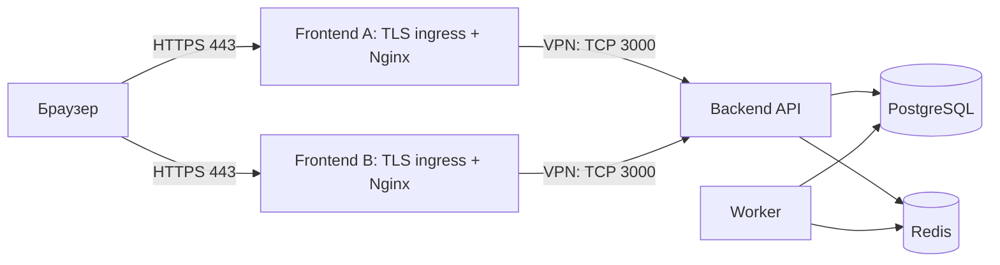

# Twenty: backend и frontend на разных серверах

Этот комплект предназначен для форка [NNN706/Twenty](https://github.com/NNN706/Twenty). Сборка и публикация выполняются в GitHub Actions, workflow `push_to_ghcr.yaml`. Образы: `ghcr.io/nnn706/twenty-backend` и `ghcr.io/nnn706/twenty-frontend`, архитектура `linux/amd64`. Используйте **одинаковый** тег `sha-<полный commit SHA>` для обоих образов. Тег latest публикуется только из main; запуск из рабочей ветки его не меняет. Digest каждого образа записывается в summary workflow; для строгой фиксации можно заменить image в Compose на `image@sha256:...`. Повторная сборка одного SHA может обновить его тег, поэтому digest является окончательной ссылкой.

## Состав и связность

Backend Compose запускает API, worker, PostgreSQL 16 и Redis 7. API и worker используют один backend image и общий том файлов. База и Redis находятся в отдельных контейнерах без опубликованных портов. Frontend Compose запускает второй image: статическую сборку приложения и Nginx, который пересылает API-запросы на backend. Объединять СУБД и Node.js в одном контейнере не требуется.



Пример адресов: backend `10.77.0.1`, frontend A `10.77.0.2`, frontend B `10.77.0.3` в заранее настроенном WireGuard или другом приватном VPN. `crm.example.com` указывает на публичный IP frontend A; `sales.example.net` — на frontend B. VPN настраивается на хостах, не внутри этих образов.

Браузер получает `/env-config.js` с `REACT_APP_SERVER_BASE_URL=window.location.origin` и обращается к API на том же HTTPS-домене. Frontend Nginx проксирует `/graphql`, `/metadata`, `/rest`, `/auth`, `/client-config`, `/file`, `/public-assets`, `/webhooks`, `/s`, `/mcp`, `/oauth`, `/.well-known`, `/open-api`, `/healthz`, `/cloudflare`, `/app/billing`, `/admin-panel`. Остальные адреса обслуживаются как SPA. Буферизация API выключена для SSE, Upgrade и cookies передаются. В браузер не попадает приватный адрес backend; доступ браузера непосредственно к TCP 3000 не нужен.

`Host` и `X-Forwarded-Proto` сохраняют публичный адрес и HTTPS. TLS завершается на хостовом Nginx; пример в `nginx-tls.conf.example`. Межсерверный HTTP допустим только внутри защищённого VPN. Подключение к backend контейнера должно работать через VPN с Docker bridge; проверьте маршрутизацию и MTU.

### Несколько frontend

На каждом frontend-хосте запустите один и тот же образ с одним `BACKEND_UPSTREAM`. Для каждой площадки настройте DNS, сертификат и TLS ingress. Пересобирать образ под домен не нужно. Можно использовать разные домены; cookies остаются first-party на каждом сайте. Сессии браузера между доменами автоматически не переносятся.

Шаблон включает `IS_MULTIWORKSPACE_ENABLED=false`: сайты — входы в одну установку и один workspace, с общей базой и пользователями. Это не изоляция клиентов и не независимые CRM. `SERVER_URL` и `FRONTEND_URL` остаются одним каноническим публичным адресом, например `https://crm.example.com`. Письма, приглашения и часть переходов после входа/SSO могут вести на него, даже если вход начат на другом сайте. OAuth callback регистрируется у провайдера на канонический адрес; не балансируйте один процесс OAuth между доменами с разными session cookies. Парольный вход и API доступны через каждый frontend, но полный OAuth/SSO-сценарий требуется проверить с реальным провайдером.

Для разных workspace используйте отдельную настройку multi-workspace и зарегистрированные workspace/custom domains в Twenty: простого добавления сайтов недостаточно. В этот шаблон такой режим не включён.

Context7 на дату проверки описывает `AUTH_COOKIE_ALLOWED_ORIGINS` и `AUTH_COOKIE_SAME_SITE` в более новом upstream. **В исходном commit этого форка `a54ddd521d9c869fd1098584bdc9a64da7d895c0` этих параметров нет**; session cookie использует `sameSite: lax`, а CORS не настроен для произвольных credentialed origins. Поэтому шаблон использует same-origin proxy и не предлагает неработающие переменные. Отдельный публичный API-домен с прямыми cross-origin запросами браузера этим комплектом не настраивается.

## Запуск

Требуются Linux amd64, Docker Engine с Compose v2, приватный VPN между серверами и HTTPS ingress на каждом frontend. Для сборки нужен доступ GitHub Actions к интернету, GHCR, npm и Docker Hub. Локальный Docker build не используется.

1. В GitHub откройте Actions → Publish split images to GHCR → Run workflow, выберите нужную ветку. Дождитесь успешной сборки **обоих** matrix jobs и integration job: он запускает API с реальной PostgreSQL/Redis, worker и два независимых frontend в GitHub runner. Для повторной проверки уже опубликованных образов укажите workflow input `existing_tag=sha-<полный SHA>`: сборка пропускается, проверяются существующие образы. У workflow есть `contents: read` и `packages: write`; используется автоматический `GITHUB_TOKEN` форка. Секреты twentyhq не нужны. Образы первоначально могут быть private: разрешите чтение нужным пользователям/репозиторию или измените package visibility вручную. Для private packages на серверах нужен отдельный токен с `read:packages`, переданный в `docker login ghcr.io --username NNN706 --password-stdin`. Не вставляйте токен в Compose или Git.
2. Скопируйте `compose.backend.yaml`, `backend.env.example` на backend, а `compose.frontend.yaml`, `frontend.env.example`, `nginx-tls.conf.example` — на каждый frontend. Секреты и env остаются на соответствующем сервере.
3. На backend:

```sh
cp backend.env.example backend.env
chmod 600 backend.env
# Отдельно сгенерируйте два разных значения, внесите их в backend.env:
openssl rand -hex 32
openssl rand -hex 32
# Заполните TAG, SERVER_URL, BACKEND_BIND_IP, POSTGRES_PASSWORD, APP_SECRET.
docker compose --env-file backend.env -f compose.backend.yaml config --quiet
docker compose --env-file backend.env -f compose.backend.yaml pull
docker compose --env-file backend.env -f compose.backend.yaml up -d --wait --wait-timeout 900
```

4. На каждом frontend:

```sh
cp frontend.env.example frontend.env
chmod 600 frontend.env
# Заполните TAG и BACKEND_UPSTREAM=http://10.77.0.1:3000.
docker compose --env-file frontend.env -f compose.frontend.yaml config --quiet
docker compose --env-file frontend.env -f compose.frontend.yaml pull
docker compose --env-file frontend.env -f compose.frontend.yaml up -d --wait
curl --fail http://127.0.0.1:3001/frontend-healthz
curl --fail http://127.0.0.1:3001/healthz
```

5. Замените домен, сертификаты и при необходимости порт в `nginx-tls.conf.example`, установите конфигурацию в host Nginx, выполните `nginx -t` и reload. Сертификаты получаются отдельно. Проверьте `https://<каждый-сайт>/client-config`, вход, запрос GraphQL, загрузку и скачивание файлов, обновления SSE, письмо-приглашение и возврат OAuth. Локальный healthcheck frontend проверяет процесс Nginx; `/healthz` проверяет связность с API. Отсутствие доступа к API должно давать 502/504, а не HTML приложения.

Для нескольких экземпляров на одном хосте меняйте `FRONTEND_PORT` и задавайте разные Compose project names через `-p`. Один backend Compose должен владеть миграциями: worker ждёт здоровый API и не запускает их повторно.

## Параметры

| Параметр | Где | Значение и назначение |
| --- | --- | --- |
| `TAG` | оба env | Обязательный одинаковый `sha-<40 символов SHA>` после успешной публикации обоих образов |
| `SERVER_URL` | backend | Обязательный канонический HTTPS URL без завершающего `/`; используется также как `FRONTEND_URL` |
| `POSTGRES_PASSWORD` | backend | Обязательный уникальный пароль; используйте hex, потому что он входит в PostgreSQL URL без дополнительного URL encoding |
| `APP_SECRET` | backend | Обязательный постоянный случайный секрет, одинаковый для API/worker; смена инвалидирует часть токенов/сессий |
| `BACKEND_BIND_IP` | backend | По умолчанию `127.0.0.1`; для двух хостов укажите **приватный VPN IP backend** |
| `BACKEND_PORT` | backend | TCP порт хоста, по умолчанию `3000`; соответствует порту в `BACKEND_UPSTREAM` |
| `TRUST_PROXY` | backend | По умолчанию `2`: host TLS ingress → frontend Nginx → API. При добавлении LB пересчитайте доверенные hops; API должен принимать трафик только от доверенных frontend |
| `BACKEND_UPSTREAM` | frontend | Обязательный URL backend через VPN, например `http://10.77.0.1:3000`; без path/query/trailing slash. Не публичный адрес frontend: иначе возникнет цикл |
| `FRONTEND_BIND_IP` | frontend | По умолчанию `127.0.0.1`, доступ только host TLS ingress |
| `FRONTEND_PORT` | frontend | По умолчанию `3001`, HTTP на loopback хоста; внутри контейнера порт `8080` |

Переменные внутри Compose зафиксированы: `NODE_ENV=production`, `NODE_PORT=3000`, `PG_DATABASE_URL` формируется из пароля, пользователя `twenty`, БД `default`; `REDIS_URL=redis://redis:6379`; `STORAGE_TYPE=local`. Для server миграции и cron включены, для worker отключены. Для SMTP, S3 и внешних интеграций добавляйте необходимые параметры **и API, и worker** в `x-backend-environment`, пользуясь конфигурацией соответствующей версии Twenty. Секреты не сохраняйте в репозитории.

## Фаерволл и VPN

Разрешения между узлами:

| Откуда | Куда | Разрешить |
| --- | --- | --- |
| Браузеры | публичный IP каждого frontend | TCP 443; TCP 80 для HTTPS redirect/ACME при его использовании |
| Администратор | каждый сервер | SSH только с доверенных IP |
| VPN peers | VPN endpoints | Порт выбранного VPN, например UDP 51820 для WireGuard |
| `10.77.0.2`, `10.77.0.3` | backend `10.77.0.1` | TCP 3000 только через VPN |
| Любой внешний узел | backend PostgreSQL/Redis | Запрет; порты 5432 и 6379 не публикуются |
| Сервисы | внешние системы | DNS, HTTPS; SMTP и другие исходящие подключения только при использовании интеграций |

В cloud security group запретите публичный входящий TCP 3000, 5432, 6379. На frontend публичные 3001/8080 не открывайте: публикация loopback уже ограничивает доступ. Backend API привязан к VPN IP и дополнительно ограничивается source IP frontend. Сначала обеспечьте доступ SSH и VPN, затем применяйте запреты; приведённые адреса — документационные примеры.

**Docker published ports могут обходить правила UFW INPUT.** Одного `ufw deny 3000` недостаточно. Для Docker с iptables backend используйте cloud firewall и цепочку `DOCKER-USER`. Пример backend-хоста для уже работающего `wg0`, IP `10.77.0.1` и порта 3000 (правила добавляются один раз; проверьте существующий порядок правил):

```sh
sudo iptables -N TWENTY-API
sudo iptables -A TWENTY-API -m conntrack --ctstate ESTABLISHED,RELATED -j ACCEPT
sudo iptables -A TWENTY-API -i wg0 -s 10.77.0.2/32 -j ACCEPT
sudo iptables -A TWENTY-API -i wg0 -s 10.77.0.3/32 -j ACCEPT
sudo iptables -A TWENTY-API -j DROP
sudo iptables -I DOCKER-USER 1 -p tcp -m conntrack \
  --ctorigdst 10.77.0.1 --ctorigdstport 3000 -j TWENTY-API
```

Сопоставление original destination необходимо из-за DNAT Docker. Правила не меняют другие контейнеры. Сохраните их механизмом своей ОС и восстановите после запуска Docker. Если используется Docker nftables backend, цепочки `DOCKER-USER` нет: создайте эквивалентную forward policy в nftables и проверьте её приоритет относительно Docker; не копируйте iptables-рецепт вслепую. IPv6 для API не публикуется этим шаблоном; при его добавлении введите эквивалентные IPv6 ограничения. Firewall самого VPN и облака должен также разрешать трафик **от Docker bridge frontend через wg0**; при строгом FORWARD policy настройте этот маршрут отдельно.

Проверьте с каждого frontend: `curl --fail http://10.77.0.1:3000/healthz`. С постороннего узла TCP 3000 должен быть недоступен. Из браузера проверяйте доступ к API через каждый HTTPS сайт. Не применяйте firewall автоматически на чужом production-сервере без проверки его текущих правил.

## Данные и обновления

Тома `database`, `storage`, `redis` находятся только на backend и сохраняются между перезапусками. Сделайте резервную копию PostgreSQL и storage до смены тега; `docker compose down -v` удаляет данные. Смена пароля в env не меняет пароль уже созданного пользователя PostgreSQL: выполните отдельную процедуру смены в БД. Для обновления остановите worker, обновите API и дождитесь миграций/health, затем обновите worker и все frontend до совместимого тега. Миграции могут сделать простой откат image недостаточным; восстановление БД требует проверенного backup.

## Источники и границы проверки

- Документация найдена через запрошенный Context7: [upstream setup](https://github.com/twentyhq/twenty/blob/main/packages/twenty-docs/developers/self-host/capabilities/setup.mdx), [Docker Compose](https://github.com/twentyhq/twenty/blob/main/packages/twenty-docs/developers/self-host/capabilities/docker-compose.mdx), [reverse proxy](https://github.com/twentyhq/twenty/blob/main/packages/twenty-docs/developers/self-host/capabilities/security.mdx). Документация main может опережать форк; при расхождении использован код форка.
- Проверенные исходники базового commit: `packages/twenty-front/src/config/index.ts`, `packages/twenty-server/src/main.ts`, `session-storage.module-factory.ts`, `domain-server-config.service.ts`, `workspace-domains.service.ts`, контроллеры API и entrypoint Docker.
- Аудит workflow: [CI-CD-REVIEW.md](CI-CD-REVIEW.md). Публикация image подтверждается только успешным workflow и digest, работоспособность реального разнесённого deployment — проверкой на целевых хостах. Эти хосты и реальные DNS/SMTP/OAuth не входят в локальную проверку шаблонов.

Проверенная пара образов, точные digest и результаты запуска: [RELEASE.md](RELEASE.md).
